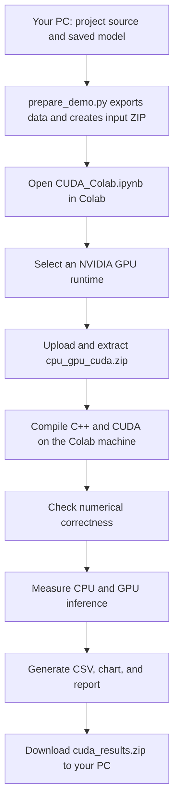

# How the whole project works

This guide follows the project from your computer to Colab and back. Start here if you can run the notebook but do not yet understand why it asks for a ZIP file.

## 1. Why does the notebook ask for a ZIP?

**Colab runs on another computer. Opening the notebook does not copy your project folder to that computer.**

The notebook contains instructions such as “compile `native/gpu.cu`” and “load the saved neural network.” Those files initially exist on your PC, so the remote machine needs a copy before it can follow those instructions.

`dist/cpu_gpu_cuda.zip` is the package that carries the source code and model data to Colab. Think of it as putting the required project files into a suitcase and sending that suitcase to the computer that has the NVIDIA GPU.

The ZIP does not provide the GPU, install a driver, or contain the CUDA Toolkit. Colab supplies the GPU environment. Our ZIP supplies **our program and its data**.

| Item | What it contains | What you do with it |
|---|---|---|
| `CUDA_Colab.ipynb` | Ordered instructions and executable notebook cells | Open it in Colab |
| `cpu_gpu_cuda.zip` | Project source, trained model, inputs, reference outputs, and guides | Upload it when the notebook asks |
| `cuda_results.zip` | Measurements, chart, report, and execution metadata | Download it after the benchmark |

These are two different ZIPs: **the input ZIP sends the experiment; the output ZIP brings the results back**.

## 2. The big picture



The measured CPU and GPU both belong to the Colab machine. Your local PC manages files and displays the browser; it does not execute the remote CUDA kernels.

## 3. What the AI actually does

The program uses a small neural network called a multilayer perceptron, or MLP:

```text
784 input features → 128 hidden units → 64 hidden units → 10 class probabilities
```

Each sample is a vector of 784 numbers. The data is synthetic: the program generates ten artificial classes. It is not recognizing real handwritten digits.

For example, the network might output ten probabilities, with class 3 having the largest value. The predicted label is then class 3. The program compares predicted labels with known labels to calculate accuracy.

There are two distinct stages:

| Stage | What happens | Code | Included in CPU/GPU timing? |
|---|---|---|---|
| Training | Adjust weights so predictions match training labels | `python/ai.py`, using NumPy | No |
| Inference | Apply saved weights to classify inputs | `native/cpu.cpp` and `native/gpu.cu` | Yes |

The saved weights make it possible to give CPU and GPU **the same trained network**, rather than training two different models.

## 4. Preparing files on your PC

The Python environment `.venv` contains the dependencies used for training, packaging, and analysis. It is not sent to Colab. Colab uses its own Python environment.

To train a new model and export it, run from the project root:

```powershell
.\.venv\Scripts\python.exe python/ai.py
```

This step is unnecessary when you want to reuse the supplied trained model. It produces or updates:

| File | Purpose |
|---|---|
| `results/ai_model.npz` | Network dimensions, learned weights, and biases |
| `results/ai_test.npz` | Test inputs and correct labels |
| `results/ai_metrics.json` | Training history and test accuracy |
| `data/native/` | Binary tensors that C++ and CUDA can read |

To create or refresh the notebook and upload package:

```powershell
.\.venv\Scripts\python.exe python/prepare_demo.py
```

`prepare_demo.py` does three things:

1. Calls `export_native()` to export the existing saved model and test data.
2. Writes the local notebook and the Colab notebook.
3. Creates `dist/cpu_gpu_cuda.zip` from an explicit list of project files.

**This packaging script does not train a missing model.** If it reports a missing `ai_model.npz` or `ai_test.npz`, run `python/ai.py` first.

## 5. What is inside the input ZIP?

The archive preserves a folder named `cpu_gpu_cuda/`:

```text
cpu_gpu_cuda/
├── native/
│   ├── native.hpp       Shared data structures and interfaces
│   ├── cpu.cpp          CPU inference implementation
│   ├── gpu.cu           CUDA inference implementation
│   └── benchmark.cpp    Timing, correctness checks, and CSV output
├── python/
│   ├── ai.py            Model, training, and binary export
│   ├── build_native.py  Native compiler commands
│   └── analysis.py      Benchmark execution, plots, and report
├── results/
│   ├── ai_model.npz     Saved trained network
│   ├── ai_test.npz      Test inputs and labels
│   └── ai_metrics.json  Saved training metrics
├── data/native/         Exported weights, inputs, and references
├── compare.py           Alternative one-command launcher
├── config.json         Network configuration
├── requirements.txt    Python dependencies
├── CMakeLists.txt       Alternative native build configuration
└── Markdown guides
```

The package excludes the local `.venv`, build caches, and Windows executable. Colab runs Linux, so it compiles its own executable from the source instead of trying to run your Windows `.exe`.

## 6. What each Colab code cell does

### Cell 1 — Check the remote GPU and compiler

```python
subprocess.run(["nvidia-smi"], check=True)
subprocess.run(["nvcc", "--version"], check=True)
```

`nvidia-smi` reports the remote NVIDIA GPU and driver. `nvcc --version` reports the CUDA compiler. `check=True` stops execution if either command fails. This avoids starting the experiment in an unsuitable runtime.

### Cell 2 — Receive and unpack your project

```python
uploaded = files.upload()
payload = uploaded["cpu_gpu_cuda.zip"]
```

`files.upload()` displays **Choose files** in the browser. The cell waits until you select a file. If it stays “running” next to that button, it may simply be waiting for your input.

Select this file from your PC, without extracting or renaming it:

```text
C:\Projetos\LIA\Mini AI Accelerator\dist\cpu_gpu_cuda.zip
```

The remaining code reads the uploaded bytes, checks archive paths, and extracts the project under:

```text
/content/cpu_gpu_cuda/
```

`ROOT` points to that directory. `sys.path.insert(...)` lets Python import helper modules from its `python/` subdirectory. It does not install a compiler or launch a GPU kernel.

### Cell 3 — Compile and validate the native program

```python
os.environ["OMP_NUM_THREADS"] = "4"
binary = build(cpu_only=False)
subprocess.run([str(binary), "--self-test", "--require-gpu"], check=True)
```

`build_native.py` calls nvcc to compile `benchmark.cpp`, `cpu.cpp`, and `gpu.cu` together. nvcc handles device compilation and uses the host C++ compiler for host code. The Linux build enables OpenMP for CPU parallelism.

The output is `/content/cpu_gpu_cuda/build/benchmark`. The variable `binary` stores its path. Compilation happens before timing and is not counted as inference latency.

Self-tests check rectangular matrix products on CPU and GPU. `--require-gpu` makes this run fail if CUDA cannot execute, rather than silently producing a CPU-only experiment.

### Cell 4 — Execute, measure, and analyze

```python
path = run_benchmark(binary, ROOT / "results" / "native",
                     batches=[1, 8, 64, 128, 256, 1024],
                     repetitions=21, warmup=5, require_gpu=True)
rows = analyze(path)
```

`run_benchmark()` loads the configuration, ensures a trained model exists, exports the binary data, and launches the native executable. The supplied package already contains a model, so the normal Colab route reuses it. If that model is absent, this helper attempts training before export.

The native executable performs full inference with the same model through four implementations:

| Name | Implementation |
|---|---|
| `cpu_naive` | Straightforward C++ loops |
| `cpu_optimized` | Better memory access, compiler vectorization, and optional OpenMP |
| `gpu_naive` | Simple parallel CUDA kernels |
| `gpu_tiled` | CUDA matrix multiplication using shared-memory tiles |

A **batch** is the number of samples in one inference call. For batch 64, one call classifies 64 samples. For batches larger than the saved test set, the executable repeats test samples to fill the batch; it does not generate extra independent test examples.

Before recording timings, each implementation warms up five times. It then measures 21 repetitions. Buffer allocation and initial weight loading are outside the timed regions. Outputs are checked against NumPy reference probabilities; a maximum absolute error above `1e-4` fails validation.

The native executable writes `benchmark.csv` and `metadata.txt`. Python records `host.json`. `analyze()` reads the CSV and produces `analysis.md` and `comparison_real.png`. The notebook displays the report and chart.

### Cell 5 — Download the results

```python
archive = shutil.make_archive("/content/cuda_results", "zip", path.parent)
files.download(archive)
```

This creates **a new ZIP**, `/content/cuda_results.zip`, from the measurements directory. Save it on your PC to keep the experiment's outputs.

## 7. What the timing metrics mean

| Metric | Meaning |
|---|---|
| CPU `wall` | Elapsed host time for CPU inference |
| GPU `device_events` | Time between CUDA stream events for the network |
| GPU `resident_wall` | Host-observed inference time with input already on GPU, including synchronization |
| GPU `transfer_wall` | Input copy to GPU, inference, output copy back, and synchronization |

GPU weights remain resident in these measurements. Input/output transfer timing does not reload the model on every call.

For an application receiving inputs in CPU memory and returning outputs there, compare **CPU `wall` with GPU `transfer_wall`**. Device event timing answers a different question and excludes some host-visible costs.

The report uses the median of repetitions and shows the 10th/90th percentiles as variability, not confidence intervals.

```text
speedup = optimized CPU time / GPU time
```

For example, CPU at 10 ms and GPU at 2 ms gives speedup 5: GPU is five times faster in that measurement. CPU at 1 ms and GPU at 2 ms gives speedup 0.5: CPU is twice as fast.

The result depends on batch size and implementation. A GPU does not automatically win, especially when launch and transfer overhead dominate small workloads.

## 8. Which result files should I open?

After extracting `cuda_results.zip`:

| File | Read it to understand |
|---|---|
| `analysis.md` | The comparison and conclusions |
| `comparison_real.png` | Latency and speedup visually |
| `benchmark.csv` | Individual algorithm/metric summaries for further analysis |
| `metadata.txt` | GPU description, build details, repetitions, and precision |
| `host.json` | Host environment and command used |

Files directly under the local `results/` root may include historical simulation outputs. For this Colab run, use the downloaded results from the notebook's `results/native/` directory.

## 9. What changes require a new upload?

The Colab files are a separate copy. Editing a file on your PC does not automatically update that copy.

If you change native or Python source locally, regenerate the package and upload the refreshed ZIP before rebuilding remotely. If you change the network dimensions and want a matching model, retrain/export before packaging; changing `config.json` alone does not replace a saved model.

Regenerating notebooks locally also does not replace a notebook already open in Colab. Reopen the updated notebook if its cells changed. Avoid overwriting local notebook edits unintentionally: `prepare_demo.py` rewrites the generated notebooks.

If Colab starts a fresh runtime, the previously uploaded project may be absent. Upload it again before running compilation or analysis cells.

## 10. The local launcher is an alternative route

`compare.py` is useful on a computer with the required hardware and tools. It calls the same build, execution, and analysis helpers without using a notebook.

On a CUDA-capable local machine:

```powershell
.\.venv\Scripts\python.exe compare.py
```

On your PC without an NVIDIA GPU, reuse the CPU executable:

```powershell
.\.venv\Scripts\python.exe compare.py --cpu-only --binary build/benchmark.exe
```

The launcher defaults to `results/comparison/`; the supplied Colab notebook uses `results/native/`. Both use the same core measurement code. The Colab notebook does not call `compare.py`: it calls its underlying helpers directly in separate cells.

## 11. Quick recovery checklist

| Where you are stuck | Next action |
|---|---|
| Upload cell stays running with “Choose files” | Click the button and select `cpu_gpu_cuda.zip`. |
| `KeyError: 'cpu_gpu_cuda.zip'` | Upload the exact generated filename; avoid browser suffixes such as `(1)`. |
| An import such as `from build_native import build` fails | Run the upload/extraction cell first and check the project folder exists. |
| Compilation fails | Read the first compiler error; do not continue to timing with an old executable. |
| Correctness checks fail | Resolve numerical differences before interpreting performance. |
| `--require-gpu` fails | Check the remote GPU runtime and the first cell's GPU/compiler output. |
| You changed local files but Colab behaves the same | Regenerate, reupload, and rebuild the remote copy. |

For implementation details, see [CODE.md](CODE.md). For CUDA setup from scratch, see [CUDA_ZERO.md](CUDA_ZERO.md).
