# Mini AI Accelerator — the same AI on CPU and CUDA GPU

This is a learning project: train a small neural network, run the same predictions on a CPU and an NVIDIA GPU, and measure which implementation is faster for different amounts of work. You do not need to understand neural networks or CUDA before reading this guide.

The central question is **“When does parallel GPU execution pay off after including its overhead?”** The answer comes from measured execution, rather than assuming that a GPU always wins.

**What was built:** a NumPy training implementation, two C++ CPU inference implementations, two CUDA GPU inference implementations, a correctness-checked benchmark, Python charts/reports, and a Colab notebook that runs the experiment on a remote NVIDIA GPU.

**For your computer without an NVIDIA GPU:** run CPU measurements locally and use the Colab notebook for the CPU/GPU comparison. Installing the CUDA Toolkit does not turn Intel or AMD graphics into a CUDA device.

Start with [RUN.md](RUN.md) for commands or [CODE.md](CODE.md) for the implementation walkthrough.

New to CUDA C++? Read [CUDA C++ from scratch](CUDA_ZERO.md) for downloads, Windows setup, your first GPU program, and the Colab route for computers without an NVIDIA GPU.

Want to understand the ZIP upload and every notebook step? Read [the complete code flow](CODE_FLOW.md).

## Read this as a guided tour

1. [Understand where everything runs](#where-everything-runs-and-why-there-is-a-zip).
2. [Understand CPU and GPU](#cpu-and-gpu-fundamentals).
3. [Understand the neural network](#the-ai-model) and [how it learns](#how-training-works-step-by-step).
4. [Follow its matrix arithmetic](#matrix-multiplication).
5. [Compare the four implementations](#four-implementations).
6. [Run locally](#running-locally) or [in Colab](#colab-and-notebooks).
7. [Understand the measurements](#measurement-methodology) and [read the results](#how-to-read-the-charts-without-being-misled).
8. [Check correctness](#validation) and [understand the limits](#limits-and-glossary).

## Where everything runs, and why there is a ZIP

Opening a notebook in Colab opens a set of instructions. It does **not** upload the rest of your project. The notebook needs source files and saved model data to execute those instructions, so we package them into `dist/cpu_gpu_cuda.zip` and upload it.

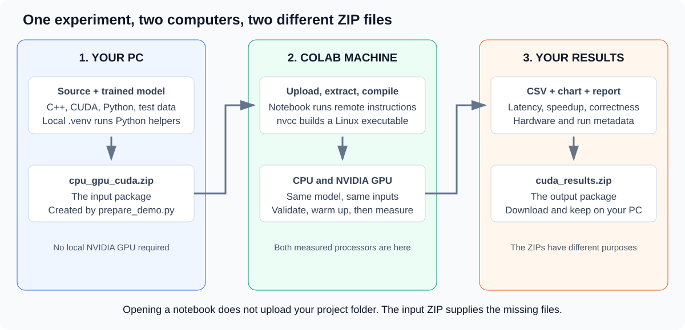

| Where | Responsibility |
|---|---|
| Your PC | Holds the project, prepares the saved model and ZIP, and displays Colab in the browser |
| Colab's CPU | Runs Python helpers, compiles the native program, executes the C++ CPU benchmark, and launches CUDA work |
| Colab's NVIDIA GPU | Executes the CUDA inference kernels |
| Your PC after download | Stores the final measurements, charts, and report |

The CPU and GPU being compared are **on the same Colab machine**. This is not a measurement of your local CPU against Google's GPU over the internet. Upload and download time are outside the inference timings.

```mermaid
sequenceDiagram
    actor User
    participant PC as Your PC
    participant Colab as Colab CPU and filesystem
    participant GPU as Colab NVIDIA GPU
    User->>PC: Run prepare_demo.py
    PC->>PC: Export saved model and create input ZIP
    User->>Colab: Open notebook and select GPU runtime
    PC->>Colab: Upload cpu_gpu_cuda.zip
    Colab->>Colab: Extract source and data; compile with nvcc
    Colab->>Colab: Validate and measure CPU inference
    Colab->>GPU: Run and measure the same network
    GPU-->>Colab: Probabilities and completed execution
    Colab->>Colab: Generate CSV, chart, and report
    Colab-->>PC: Download cuda_results.zip
```

There are **two different ZIP files**:

| ZIP | Direction | Contents |
|---|---|---|
| `cpu_gpu_cuda.zip` | Your PC → Colab | Source code, trained model, test inputs, reference outputs, and guides |
| `cuda_results.zip` | Colab → your PC | New measured results and execution metadata |

Neither ZIP supplies physical GPU hardware. The input package also excludes `.venv` and Windows executables: Colab uses its own Python environment and compiles a Linux executable.

## CPU and GPU fundamentals

A CPU uses relatively few powerful cores. Each core handles branches, instruction scheduling, and general-purpose work, with caches that keep frequently used data close to execution units. CPUs are effective at sequential work and workloads where low latency matters.

A GPU uses many simpler execution units to process large amounts of similar work. CUDA organizes threads into blocks and grids. Threads execute in groups called warps; a warp contains 32 threads. GPUs achieve high throughput when enough independent work is available.

**Parallelism** means splitting independent work among workers. For example, if 1,024 input samples need the same calculation, many parts can be processed concurrently. This helps only when enough useful work exists to justify coordinating those workers.

The drawings below are conceptual illustrations, not the literal core counts of the machine being measured.

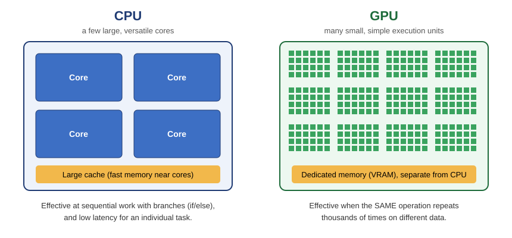

| Property | CPU | CUDA GPU |
|---|---|---|
| Design focus | General-purpose execution and latency | Parallel throughput |
| Memory | System RAM and caches | VRAM and shared memory |
| Useful workload | Branching and sequential tasks | Repeated independent arithmetic |
| Implementation | C++ | CUDA C++ |
| Data movement | Inputs already in host memory | Host/device transfers for nonresident data |

Think of a CPU as a small team of experienced chefs and a GPU as a large team doing the same preparation step. A large order can benefit from parallel workers, but ingredients and finished dishes must be transported. For a small order, transport and setup can dominate.

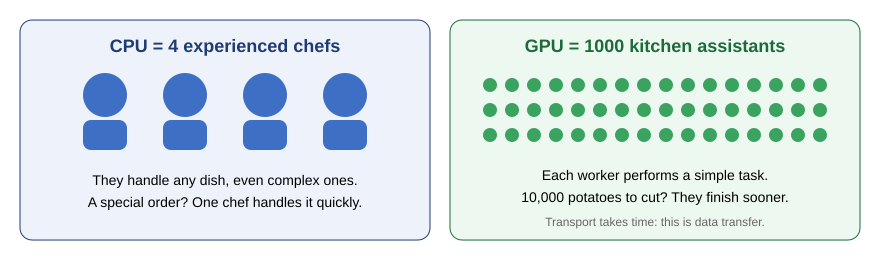

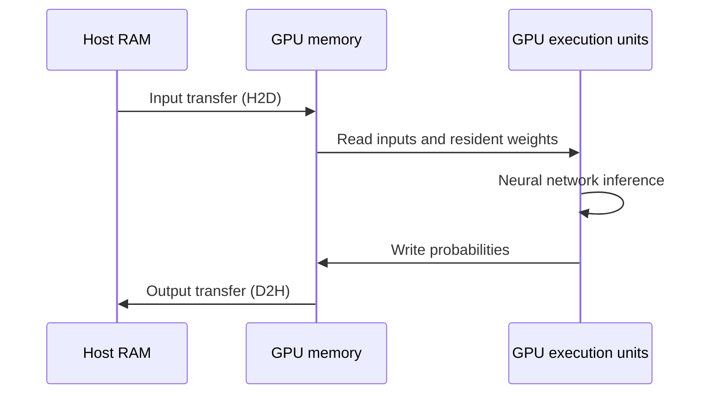

The benchmark measures both resident-data execution and execution including input/output transfers.

## The AI model

The model is a multilayer perceptron (MLP), a neural network of fully connected layers:

| Layer | Units | Activation |
|---|---:|---|
| Input | 784 | None |
| Hidden 1 | 128 | ReLU |
| Hidden 2 | 64 | ReLU |
| Output | 10 | Softmax |

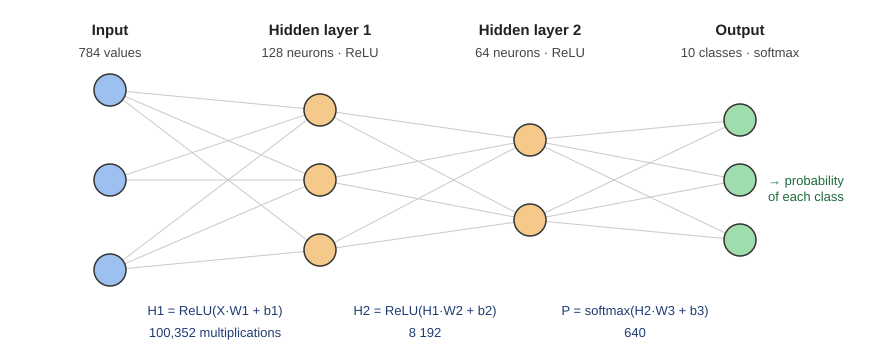

Each neuron calculates a weighted sum plus a bias. ReLU keeps positive values and replaces negative values with zero. Softmax converts output logits into class probabilities.

### Follow one sample

An input is a vector of 784 numbers, called **features**. A class is the category the sample belongs to, represented by a label from 0 through 9. The model combines these features through its hidden layers and produces ten probabilities. The largest probability determines its predicted label.

For an illustrative output `[0.02, 0.03, 0.90, 0.01, 0.01, 0.01, 0.005, 0.005, 0.005, 0.005]`, the prediction is class 2 because its probability is the largest. This example explains the format; it is not an output recorded from a benchmark run.

| Term | Plain-language meaning |
|---|---|
| Weight | A learned number controlling how much an input contributes |
| Bias | A learned offset added to a neuron's sum |
| Hidden layer | An intermediate transformation of the input |
| ReLU | `max(0, value)`: retain positive signals and zero negative ones |
| Logit | An output score before converting it into a probability |
| Softmax | A conversion of scores into nonnegative probabilities summing to one |
| Prediction | The class with the highest output probability |

For a miniature neuron with inputs `[2, -1]`, weights `[0.5, 0.2]`, and bias `0.1`, the weighted sum is `2*0.5 + (-1)*0.2 + 0.1 = 0.9`. ReLU returns `0.9`. Real layers perform many such sums together.

```text
H1 = ReLU(X @ W1 + b1)
H2 = ReLU(H1 @ W2 + b2)
P  = softmax(H2 @ W3 + b3)
```

Softmax subtracts the largest logit before exponentiation to avoid overflow:

```text
p[j] = exp(z[j] - max(z)) / sum(exp(z - max(z)))
```

The synthetic dataset is generated locally with seed 42. Each of ten classes has a center in the first 32 features; remaining features contain noise. There are 3,000 training samples, 600 validation samples, and 600 test samples, generated independently with shared class centers. This is **not MNIST or image recognition**.

The number 784 is an input width, not evidence that these inputs are images. We use an intentionally controlled classification problem to focus on inference implementation and timing. A fixed random seed makes generation reproducible; it does not make every machine's timing identical.

Training uses NumPy, Adam, a learning rate of 0.001, minibatches of 128, and 12 epochs by default. Validation accuracy selects the best checkpoint. The test split is evaluated only after selection. Inspect `results/ai_metrics.json` for the saved run; accuracy depends on configuration.

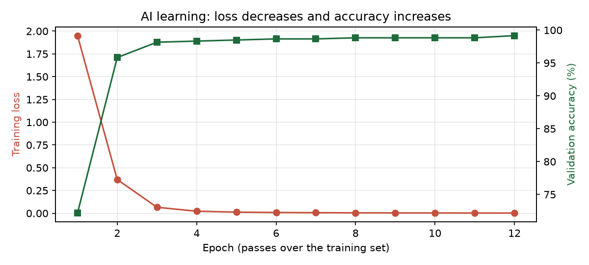

Training adjusts parameters. Inference classifies new inputs using those parameters. **This project compares inference performance; training is outside the CPU/GPU timings.**

### How training works, step by step

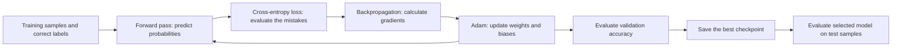

**Loss** is a numerical penalty for poor predictions. **Gradients** describe how the parameters should change to reduce that penalty. **Backpropagation** calculates those gradients through the layers. **Adam** uses them to update the parameters.

An **epoch** is one pass over the training set. A **training minibatch** is a small group used for one parameter update. This is different from the **inference batch sizes** varied during the benchmark.

The three data splits have different jobs:

| Split | Job | Used to update weights? |
|---|---|---|
| Training | Learn parameters from examples | Yes |
| Validation | Choose the best saved checkpoint | No |
| Test | Evaluate the selected model after checkpoint selection | No |

The stored training run reports `599/600`, or approximately **99.83%**, test accuracy in `results/ai_metrics.json`. That is a result on this synthetic problem, not a promise for other datasets. Accuracy and execution speed answer different questions: a fast implementation is useful only if it produces correct outputs.

The training plot above reads saved training history. Its left axis is training loss; its right axis is validation accuracy. A falling loss means the training objective is improving, while validation accuracy checks performance on samples not used for parameter updates.

## Matrix multiplication

Each dense layer multiplies `A[M,K]` by `B[K,N]` to produce `C[M,N]`:

```text
C[i,j] = sum(A[i,k] * B[k,j] for k in range(K))
```

Every output element can be calculated independently. The model performs `784*128 + 128*64 + 64*10 = 109,184` multiply-accumulate operations per sample, excluding bias and activations. A batch of 1,024 requires approximately 112 million such operations.

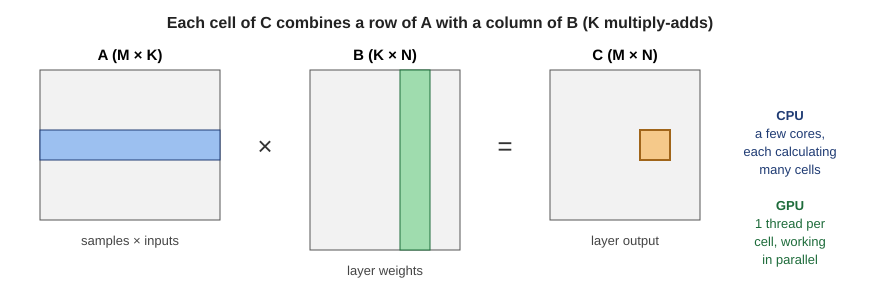

For a batch of 64 inputs, the actual matrix shapes are:

| Layer | Input matrix | Weight matrix | Output matrix |
|---|---|---|---|
| First hidden | `64 × 784` | `784 × 128` | `64 × 128` |
| Second hidden | `64 × 128` | `128 × 64` | `64 × 64` |
| Output | `64 × 64` | `64 × 10` | `64 × 10` |

`M` means samples, `K` means input features for the current layer, and `N` means output units. Biases and activations are applied after the product. The GPU can compute many output elements in parallel because each dot product contributes to its own output element.

## Four implementations

All implementations use identical weights, inputs, dense layers, biases, ReLU, and softmax. Correctness is checked against NumPy.

| Implementation | Technique |
|---|---|
| `cpu_naive` | Sequential i-j-k loops |
| `cpu_optimized` | i-k-j loops, blocking, compiler SIMD, optional OpenMP |
| `gpu_naive` | One CUDA thread per matrix output |
| `gpu_tiled` | Shared-memory tiles and barriers |

The naive CPU reads columns of row-major B, jumping between rows. The optimized CPU traverses contiguous B and output values, improving cache locality and enabling compiler vectorization. OpenMP optionally distributes independent rows; parallel startup is included in the timing.

The naive CUDA kernel assigns one output to each thread in a 16 × 16 block. The tiled kernel loads A and B tiles into shared memory, synchronizes, and reuses operands. Edge threads load zeros and participate in barriers. A second barrier prevents overwriting data still used by other warps. Tiling does not guarantee a win: padding and synchronization can outweigh reuse on small matrices.

### Why changing CPU loop order helps

Matrices are stored row by row. Reading a row walks through neighboring memory; reading a column jumps between rows. The naive i-j-k ordering repeatedly reads columns of the weights. The optimized i-k-j ordering walks across rows of weights and output values, which better suits caches and SIMD.

**SIMD** lets one CPU instruction operate on several numbers. **OpenMP** can distribute independent rows among CPU threads when compiler support is enabled. These are CPU optimizations, even though they also involve parallel work.

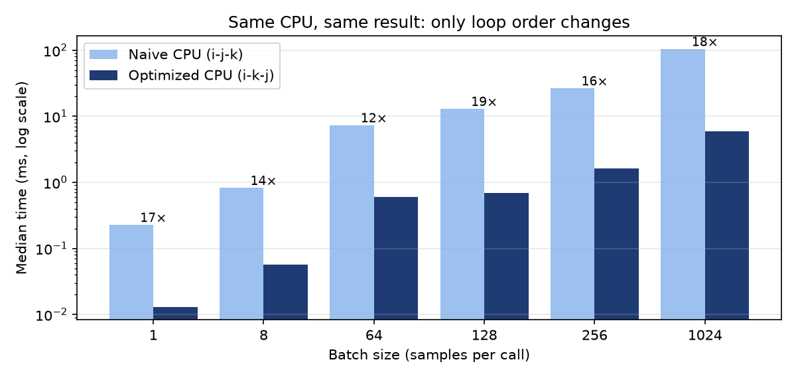

This image comes from the saved `results/native/benchmark.csv` CPU rows. It compares CPU implementations; it is not evidence that a GPU ran. Its vertical axis is logarithmic, so use the labels and ratios instead of interpreting bar heights as a linear scale. Regenerate it with `python/figures.py` after updating the saved measurements.

### What CUDA threads, blocks, and tiles mean here

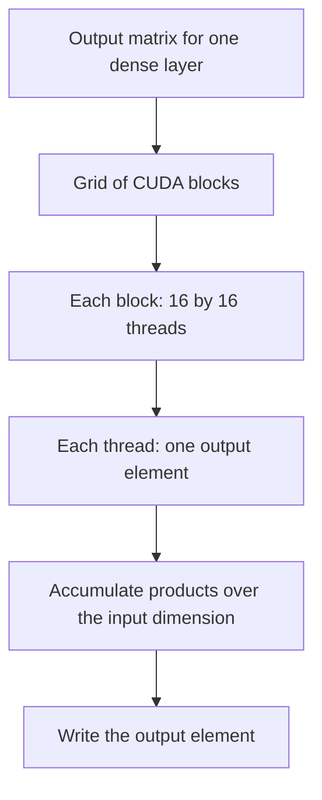

A **thread** is one logical worker. A **block** groups workers that can share fast on-chip memory and synchronize. The **grid** contains the blocks for a kernel launch. A **tile** is a small matrix region loaded for reuse, rather than fetched from global device memory repeatedly.

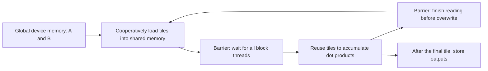

The **AI algorithm remains the same** in both GPU versions. Their difference is how matrix multiplication is scheduled and how operands are reused. Bias/ReLU and softmax kernels complete the inference; this benchmark does not time matrix multiplication alone.

### What happens inside a GPU inference


The GPU does not independently read Python model files or decide what to run. The host program allocates buffers, copies parameters, launches kernels in a stream, and waits when it needs completed results.

## Project layout

```text
compare.py                 Build, execute, and analyze in one command
native/native.hpp          Matrix/model structures and common interface
native/cpu.cpp             CPU inference, loading, numerical checks
native/gpu.cu              CUDA kernels, transfers, buffers, timing
native/benchmark.cpp       CLI, warmups, repetitions, validation, CSV
python/ai.py               Dataset, training, FP32 export
python/build_native.py     Compiler selection and builds
python/analysis.py         Measurements, plots, Markdown reports
python/prepare_demo.py     Notebooks and portable CUDA package
python/figures.py          README figures from saved measurements
tests/test_ai.py           Model and export checks
notebooks/                 Local and Colab workflows
data/native/               Exported FP32 tensors
results/                   Model, measurements, reports
```

Model artifacts use English `ai_*.npz` and `ai_*.json` names.

### How the languages work together

| Part | Why it exists |
|---|---|
| Python/NumPy | Express the reference model, train it, and export data |
| C++ | Execute CPU inference and manage the native benchmark |
| CUDA C++ | Execute GPU kernels and manage device transfers/timing |
| Python/Matplotlib | Turn measurements into plots and explanations |
| Notebook | Present these steps as cells that can run in Colab |

Python starts a compiled executable through `subprocess`. The native program reads binary matrices and writes CSV measurements. Python then reads that CSV. There is no custom Python extension binding and no PyTorch/TensorFlow dependency in this implementation.

The binary matrix format is deliberately small: two little-endian uint32 values for rows and columns, followed by row-major FP32 values. This makes the same exported numbers available to both C++ and CUDA without requiring them to parse a NumPy archive.

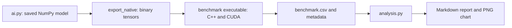

## Running locally

Use this route for local CPU work, or for both devices when you have a compatible NVIDIA GPU. For your current non-NVIDIA PC, the Colab route below supplies the CUDA hardware.

```powershell
python -m venv .venv
.\.venv\Scripts\python.exe -m pip install -r requirements.txt
.\.venv\Scripts\Activate.ps1
python compare.py
```

CUDA requires a compatible NVIDIA GPU, driver, CUDA Toolkit, and supported C++ compiler. On Windows, use the **Visual Studio x64 Native Tools terminal** with C++ support. The launcher requires GPU execution unless `--cpu-only` is specified:

```powershell
python compare.py --cpu-only
python compare.py --cpu-only --binary build/benchmark.exe
```

See [CUDA_SETUP.md](CUDA_SETUP.md) for compiler setup and CUDA/C++ linking. Virtual environment activation is optional; `.\.venv\Scripts\python.exe compare.py` uses it directly.

Run stages separately if preferred:

```powershell
python python/ai.py
python python/build_native.py --cpu-only
python python/analysis.py --run --cpu-only
```

For CUDA, omit `--cpu-only` when building and require the GPU when measuring:

```powershell
python python/build_native.py
python python/analysis.py --run --require-gpu
```

Alternative CMake build:

```powershell
cmake -S . -B build/cmake -DENABLE_CUDA=ON
cmake --build build/cmake --config Release
ctest --test-dir build/cmake -C Release --output-on-failure
```

CMake can fall back to CPU if a CUDA compiler is missing. Use `--require-gpu` when executing to enforce CUDA availability, or `-DENABLE_CUDA=OFF` for an explicit CPU-only CMake build.

## Colab and notebooks

```powershell
python python/prepare_demo.py
```

Open `notebooks/CPU_GPU.ipynb` locally or `notebooks/CUDA_Colab.ipynb` in Colab. The Colab notebook requests `dist/cpu_gpu_cuda.zip`, compiles remotely, and compares that machine's CPU and GPU. GPU availability depends on the runtime.

### Colab walkthrough from the browser

1. Open Colab and upload `notebooks/CUDA_Colab.ipynb`.
2. Select **Runtime → Change runtime type → an available GPU**. In the Portuguese interface, use **Ambiente de execução → Alterar tipo de ambiente de execução**.
3. Run the cells in order, or click **Run all / Executar tudo**.
4. At **Choose files / Escolher arquivos**, upload `dist/cpu_gpu_cuda.zip` without extracting it. A cell waiting at this button is waiting for you, not benchmarking yet.
5. Let compilation and correctness checks finish before interpreting any timings.
6. Read the chart/report and download `cuda_results.zip` when offered.

| Code cell | What it does | What you should expect |
|---|---|---|
| 1 | Runs `nvidia-smi` and `nvcc --version` | GPU/driver and compiler information |
| 2 | Uploads and extracts the input ZIP | File selector, then project under `/content/cpu_gpu_cuda/` |
| 3 | Compiles source and runs numerical self-tests | Compiler output and passed checks |
| 4 | Measures CPU/GPU inference and analyzes CSV | Timing lines, chart, and Markdown report |
| 5 | Packages and downloads results | `cuda_results.zip` |

The notebook calls `build()`, `run_benchmark()`, and `analyze()` directly. The local `compare.py` launcher calls the same helpers in one command.

`prepare_demo.py` exports an **existing saved model**, rewrites the generated notebooks, and packages files; it does not train a missing model. If model files are absent, run `python/ai.py` first. In normal use, the supplied model is reused, so every Colab run does not have to retrain.

If you edit source locally, regenerate the ZIP, upload it again, and rebuild in Colab. The remote copy does not update automatically. If the notebook cells themselves changed, reopen the refreshed notebook. A fresh Colab runtime also needs a fresh upload.

## Measurement methodology

Defaults are batches `1, 8, 64, 128, 256, 1024`, five warmups, and 21 repetitions. Timed paths exclude model loading and buffer allocation on both processors.

| Metric | Includes |
|---|---|
| CPU `wall` | Host wall time for the network |
| GPU `device_events` | Interval between stream events for the network |
| GPU `resident_wall` | Host wall time with resident inputs and synchronization |
| GPU `transfer_wall` | Input H2D, network, output D2H, synchronization |

GPU weights remain resident. Transfer timing uses pinned host memory. CUDA events include intervening kernels and possible submission gaps; they differ from total host-visible latency.

Compare CPU wall time with GPU transfer-inclusive wall time for repeated inference with host inputs and outputs. Use resident timing when the application keeps data on the GPU.

Median latency summarizes repetitions. The 10th and 90th percentiles describe spread, not confidence intervals. Speedup is `optimized CPU time / GPU time`: above 1 favors GPU, below 1 favors CPU. Throughput is `batch_size * 1000 / median_ms` samples per second.

The first tested winning batch is a sampled observation, not an exact crossover or universal threshold. Small differences relative to variability need more runs.

### What one benchmark run actually repeats

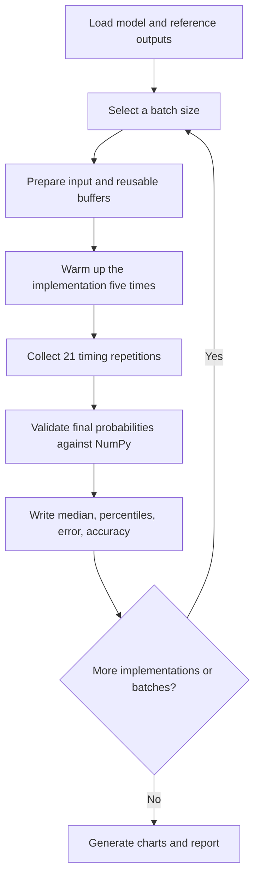

Batch size controls work per call, not the number of repetitions. A batch of 1,024 means one call handles 1,024 samples. The exported test set has 600 samples, so larger batches repeat existing test inputs to fill the batch rather than introducing more independent examples.

The optimized CPU defaults to four OpenMP threads through the Python helper unless already configured. A CPU build without OpenMP still runs its optimized loops, but does not gain OpenMP threading. Inspect metadata instead of assuming a build used every CPU core.

The GPU timings answer two application scenarios: “my inputs are already on the GPU” and “my inputs and outputs are in host memory.” In both, weights are preloaded. Cold initialization, model loading, and all buffer allocation remain outside timing.

## Results

The launcher writes `results/comparison/analysis.md`, `comparison_real.png`, `benchmark.csv`, `metadata.txt`, and `host.json`. Lower-level analysis defaults to `results/native/`. CPU-only reports explicitly state that CUDA was not run. Preserve metadata when presenting results.

Small batches can favor CPU because GPU launch, transfer, and synchronization costs dominate. Larger batches expose more parallelism. Outcomes depend on hardware, compiler, network dimensions, memory behavior, and implementation.

Older files directly under `results/`, including `analysis.md` and `comparison.csv`, describe a **historical hypothetical simulation**, not physical GPU measurements. Current measured results are in dedicated subdirectories.

### Performance images: measured CPU results

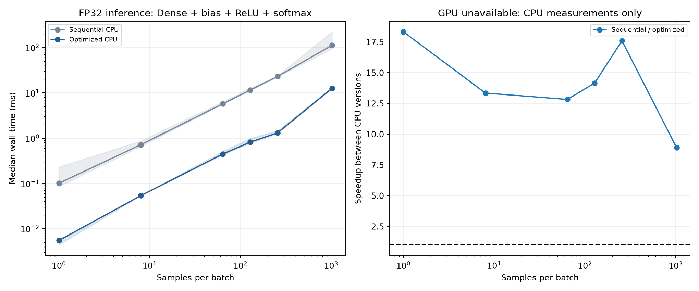

This chart shows the saved local run in `results/comparison/benchmark.csv`. The left panel compares median inference time for naive and optimized CPU code, including percentile bands. The right panel shows their speedup. **Both curves are CPU implementations: this run's metadata records `gpu_executed=0`.**

### CPU versus GPU illustration: historical simulation

**The next image is a historical hypothetical simulation, not a measurement of an NVIDIA GPU or the Colab T4.** Its modeled times must not be used as conclusions about the current native benchmark. The historical model covered dense matrix products only; the current benchmark also includes biases and activations.

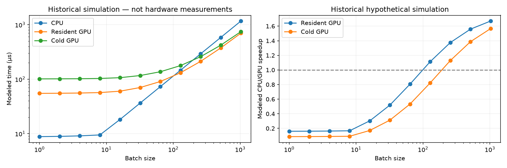

The left panel illustrates modeled CPU, resident-GPU, and cold-GPU times at different batch sizes. The right panel illustrates modeled speedup: above the dashed line means the modeled GPU path is faster. These curves help explain how overhead can affect small workloads, but do not establish a measured crossover for actual hardware.

### Where the actual Colab CPU versus GPU chart comes from

After the GPU notebook finishes, its downloaded `cuda_results.zip` contains `comparison_real.png`, `benchmark.csv`, `metadata.txt`, and `host.json`. With GPU measurements present, that chart compares CPU and CUDA latency and shows GPU speedup with resident data and input/output transfers.

**The real Colab GPU results have not been imported into this repository yet.** Keep the downloaded files together and check `gpu_executed=1` in metadata before presenting them as CPU/GPU measurements. The historical simulation above is not a substitute for that run.

### How to read the charts without being misled

The generated `comparison_real.png` has two panels:

| Panel | Horizontal axis | Vertical axis | Interpretation |
|---|---|---|---|
| Latency | Samples per batch | Median milliseconds | Lower time is better for that batch |
| Speedup | Samples per batch | CPU time divided by compared time | Above 1 favors the compared GPU implementation in a GPU run |

If the file contains CPU-only measurements, the second panel compares naive CPU with optimized CPU and explicitly labels that difference. Check the legend before interpreting a ratio as GPU speedup.

Shaded latency bands show percentiles 10–90. Logarithmic axes make large ranges visible; evenly spaced positions do not necessarily represent evenly spaced numerical differences.

Consider these **invented examples**, used only to explain the calculation:

| CPU time | GPU time including copies | CPU/GPU | Conclusion for that example |
|---:|---:|---:|---|
| 10 ms | 2 ms | 5 | GPU is 5 times faster |
| 1 ms | 2 ms | 0.5 | CPU is 2 times faster |
| 2 ms | 2 ms | 1 | Equal median latency |

A larger batch may take more milliseconds per call while still delivering more samples per second. For example, 1 sample in 1 ms is 1,000 samples/s; 100 samples in 10 ms is 10,000 samples/s. **Latency per call and throughput are different goals.**

Keep `metadata.txt` and `host.json` with the CSV. Do not present the saved local CPU chart as a Colab GPU result: use the actual downloaded Colab output for claims about that run. No CPU/GPU winner can be established from local CPU-only measurements.

## Validation

```powershell
python -m unittest discover -s tests -v
build/benchmark.exe --self-test --cpu-only
```

On a CUDA build and compatible machine:

```powershell
build/benchmark.exe --self-test --require-gpu
```

Python checks probability normalization, model persistence, dataset splits, and binary export. Native tests cover rectangular products and boundary dimensions. Benchmark runs validate full-network probabilities against NumPy with maximum absolute error tolerance `1e-4`.

The numerical self-tests cover 27 CPU matrix-shape combinations and 54 GPU products across the two GPU kernels. They include awkward dimensions so edge tiles are exercised, rather than testing only convenient multiples of 16.

Maximum probability error checks whether implementations produce nearly the same numbers. Classification accuracy checks whether the largest output agrees with the known label. These checks have different purposes: two implementations can agree perfectly on an incorrect prediction made by the trained model.

## Limits and glossary

These educational kernels do not measure peak BLAS, cuBLAS, Tensor Core, or framework performance. The CPU can use SIMD and optional OpenMP, but neither implementation is the best possible implementation.

The benchmark measures warmed-up inference with preallocated buffers and resident weights. It does not measure training speed, cold context creation, first-call latency, power consumption, or price/performance. Synthetic accuracy does not establish real-image accuracy.

The project name does not mean that a new physical accelerator was designed. The implementation runs on existing processors and compares different ways to execute the same network.

### Questions you should be able to answer after reading

| Question | Answer |
|---|---|
| What AI algorithm is running? | An MLP classifier with three dense transformations |
| What differs between CPU and GPU? | Where and how the same inference arithmetic executes |
| Does the GPU train the model here? | No; this implementation trains with NumPy and benchmarks native inference |
| Why upload a ZIP? | The remote machine needs source code and saved data that opening a notebook does not transfer |
| Does the ZIP contain CUDA? | No; the GPU runtime provides the compiler and hardware environment |
| What does tiled CUDA change? | Operand reuse through shared memory, not the mathematical model |
| Which GPU time matters for host input/output? | `transfer_wall`, including copies and synchronization |
| Is GPU guaranteed to win? | No; overhead and workload size matter |
| Where are the actual results? | The run's CSV, chart, report, and metadata, downloaded from Colab |

### Further reading inside this repository

| Guide | Purpose |
|---|---|
| [CODE_FLOW.md](CODE_FLOW.md) | Follow every file transfer and notebook cell |
| [CODE.md](CODE.md) | Walk through implementation functions and data formats |
| [CUDA_ZERO.md](CUDA_ZERO.md) | Learn CUDA setup from scratch, including the no-NVIDIA route |
| [CUDA_SETUP.md](CUDA_SETUP.md) | Check compiler setup and linking commands |
| [RUN.md](RUN.md) | Find short commands for running the experiment |

### Glossary

| Term | Meaning |
|---|---|
| Batch | Samples processed in one call |
| Latency | Time to complete one call |
| Throughput | Samples processed per unit time |
| FP32 | 32-bit floating-point arithmetic |
| SIMD | One CPU instruction operating on multiple elements |
| Warp | Group of 32 CUDA threads |
| Tile | Matrix block reused during computation |
| H2D / D2H | Host-to-device / device-to-host transfer |
| Warmup | Untimed execution before measurements |
| Speedup | Reference time divided by compared time |
# Mini-AI-Accelerator

